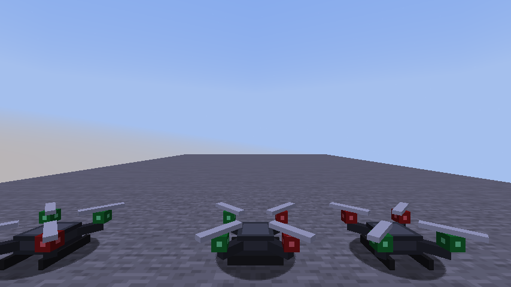

# Minecraft Mods

Frankie's custom mods for **Minecraft: Java Edition**, built with [Fabric](https://fabricmc.net/).
Each mod is a small, self-contained project under [`mods/`](mods/).

| Mod | What it does | Minecraft | Status |
|---|---|---|---|
| [**Drone**](mods/drone/) | A rideable quadcopter that flies like a real camera drone: it tilts into moves, carries momentum, brakes, and holds altitude | 26.3 | v1 done, play-tested |



## Try a mod

1. Install **JDK 25** (macOS: `brew install openjdk@25`; Windows/Linux: [Eclipse Temurin 25](https://adoptium.net/)) and point `JAVA_HOME` at it.
2. Clone the repo and launch a development copy of Minecraft with the mod loaded:

   ```bash
   git clone https://github.com/SpacePlushy/Minecraft-mods.git
   cd Minecraft-mods/mods/drone
   ./gradlew runClient
   ```

It runs in its own sandbox, so your normal Minecraft install and worlds aren't touched. The first run downloads Minecraft and takes a few minutes.

## How this repo is organized

```
docs/superpowers/specs/   design docs: what each mod should do, and why
docs/superpowers/plans/   step-by-step build plans, plus a progress ledger
mods/<name>/              one independent Fabric project per mod
```

Mods are built with [Claude Code](https://claude.com/claude-code) using a spec → plan → test-driven workflow (the *superpowers* plugin). [`CLAUDE.md`](CLAUDE.md) holds everything Claude needs to pick the work back up on any machine: current status, setup, conventions and gotchas.

## Tests

Each mod has fast unit tests for its game logic, plus in-game tests that launch Minecraft, play through scenarios, and save screenshots:

```bash
cd mods/drone
./gradlew test               # unit tests (seconds)
./gradlew runClientGameTest  # in-game tests (about a minute; opens a game window)
```
