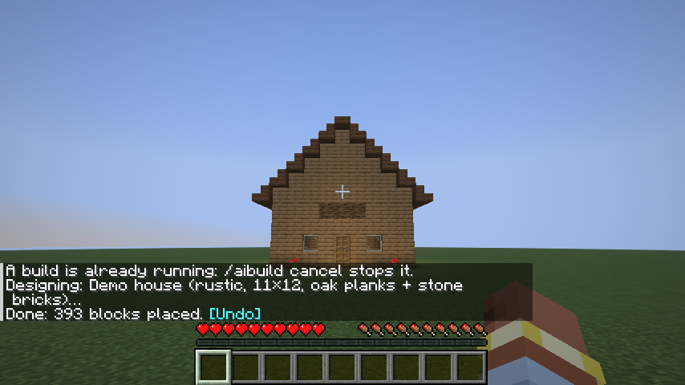
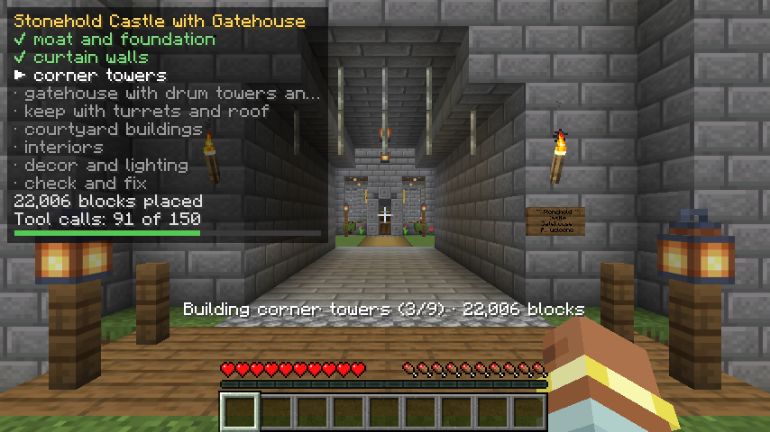
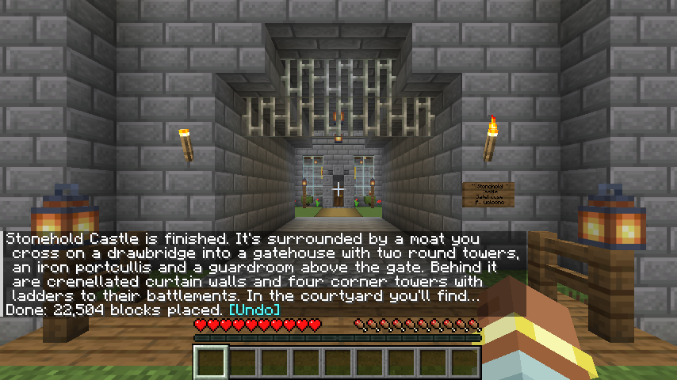
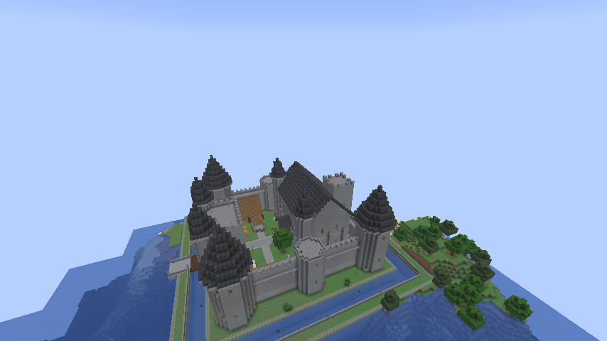
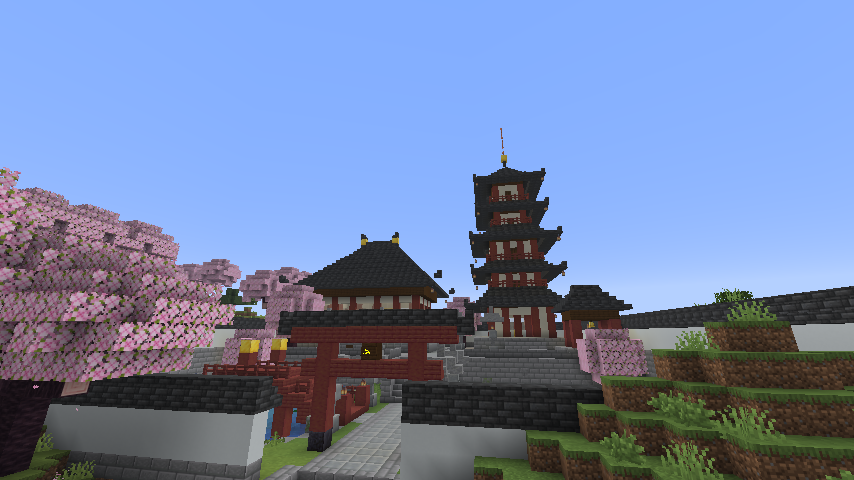
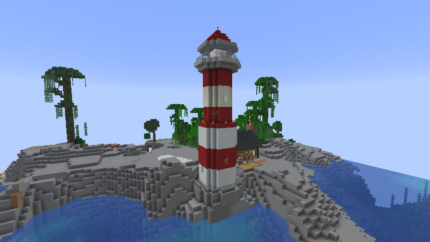
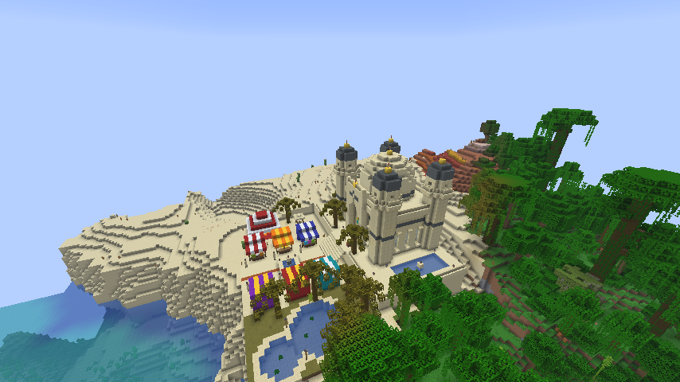
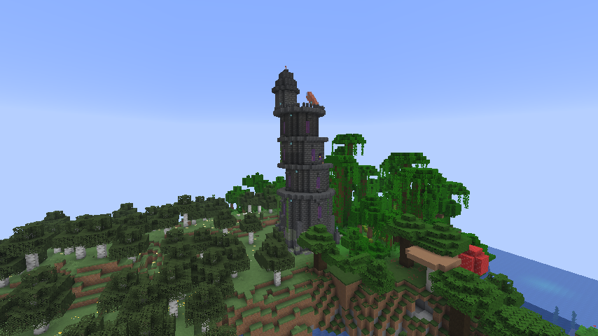

# AI Builder

A mod for **Minecraft Java Edition 26.3** (Fabric) where you press **B**, type anything ("castle", "a cozy cabin
with a dock", "a Japanese garden with a koi pond"), and Claude designs it and builds it in front of you, block by
block, while you watch. It never moves you, ignores your inventory, and `/aibuild undo` puts the land back.

**Status: M6, all six milestones built.** Type a prompt and Claude builds it, using Claude Code on your own Claude
login (Pro or Max). A panel in the top-left corner shows the build's plan as it goes: its phases ticking off, the
blocks placed and how much of its budget it has used. Claude checks its own work before it finishes (dark rooms,
blocked doors, floating torches, low ceilings, water that would spill) and dresses builds with signs, stocked
chests, a lectern with a book, banners and item frames. Lava never goes in next to anything that burns. Type a
follow-up next to a build ("add a moat") and Claude changes that build. Every build leaves a log, and a settings
file sets the caps, the speed and who may build. `/aibuild test` builds a demo house without Claude, `/aibuild
survey` shows how Claude sees the land, and `/aibuild undo` takes any build back, item frames included. The plan,
milestone by milestone, is in [`PLAN.md`](PLAN.md).

## What you need

- **Claude Code**, installed and logged in with your Claude subscription: in a terminal, run `claude` once and log
  in. AI Builder finds it in the usual places (`~/.local/bin/claude` and the like) and never sees your login.
- Builds count against your plan's usage limits: at the plan's limit a build stops. AI Builder never builds on paid
  extra usage: it stops at the first sign of it, and if your account allows extra usage it stops already when the
  plan is about 95% used. Claude Code reports extra usage only after the step that used it, so for a hard guarantee
  keep extra usage turned off in your Claude account. A build also stops at 150 tool calls, 500,000 output tokens or
  45 minutes. Whatever it built stays, and `/aibuild undo` reverts it.
- Only prompts you type build: a command from a click (a link in a book or on a sign) can't start one.








## Using it

| Do | What happens |
|---|---|
| Press **B** in a world | The AI Builder screen opens (rebind it in Options → Controls → Key Binds → AI Builder). While a build runs, it shows what's under way and **Build** becomes **Stop build** |
| Type what you want, pick a **Size**, press **Build** | Claude looks at the land, plans, then builds in front of you while the panel in the top-left corner ticks off its phases and the action bar shows the block count. It takes a few minutes; chat says `Done: …` with a clickable **[Undo]** at the end |
| Click a recent prompt (▲ ▼ scroll through the last 10) | It goes back in the box, ready to build again |
| `/aibuild <prompt>` in chat | Same as Build, at Auto size |
| Type another prompt near your last build | Claude changes that build ("add a moat", "make the towers taller"): it picks up its own plan where it left off and may build up to 16 blocks past what it built. The screen says **Refining: *name***; click that to make a new build there instead. Each change is its own undo |
| `/aibuild new <prompt>` | A new build, even next to your last one |
| `/aibuild test` | Builds the demo house 3 blocks in front of you, facing the way you face, slowly enough to watch (about 10 seconds). The action bar shows the phase and the block count; chat says `Done: …` with a clickable **[Undo]** |
| `/aibuild undo` | Takes back your newest build (repeat for older ones: the last 5, or as many as `undo_history_size` says), even after the game crashed or restarted. Anything you changed since, like a chest you filled, stays |
| `/aibuild cancel` | Stops the build at once (Claude too); what's placed stays and can be undone |
| `/aibuild status` | The phase, blocks placed and tool calls used so far |
| `/aibuild survey` | Reads the spot in front of you the way a build does and shows what Claude will "see": heights, water, trees and any player-made blocks, with the full text saved in `aibuilder/surveys/` |

The screen remembers your last 10 prompts and the size you picked last. Prompts can be up to 2,000 characters.
A prompt changes your last build when you stand within 48 blocks of it in the same world, after a restart too; it
keeps that build's size. Undoing a change takes back just the change.
Only the world's owner can build. Builds never move you: a spot you're standing in waits until you step away.
Builds leave your own blocks alone: anything that doesn't look like natural terrain or plants (a house, a farm, a
village) counts as yours, and a build won't replace it unless you ask for that. It's a rule of thumb, so a log cabin
looks like trees to it; `/aibuild undo` is always there.

## Settings

`config/aibuilder.json` in the game folder is written the first time you use AI Builder (a command or the screen), with every setting at its
default; edits apply to the next build, no restart needed. A value that's wrong falls back to its default, with a
warning in the log.

| Setting | Default | What it does |
|---|---|---|
| `model`, `effort` | `claude-opus-5-5`, `high` | The Claude model builds use, and how hard it thinks (`low` … `max`) |
| `claude_path` | empty | Where Claude Code is, if AI Builder doesn't find it by itself |
| `size_limits` | 15,000 / 100,000 / 350,000 / 1,000,000 | Blocks one build may change, Small to Epic |
| `blocks_per_tick`, `animate_build` | 250, `true` | How fast blocks go in; `false` places 8 times as many a tick (the game's time per tick still caps it) |
| `max_tool_iterations`, `max_tokens_per_build`, `max_build_minutes` | 150, 500,000, 45 | When a build is stopped |
| `undo_history_size` | 5 | Builds per player that `/aibuild undo` can take back (up to 50) |
| `protect_player_blocks` | `true` | Builds leave blocks that look player-made alone; `false` lets them replace anything but unbreakable blocks |
| `site_gap` | 3 | How far in front of you a build starts |
| `banned_blocks` | TNT, spawners, fire… | Blocks a build never places (unbreakable blocks never anyway). A list with no valid block id in it keeps the default; `[]` bans nothing |
| `backend` | `claude_code` | `scripted` makes every prompt build the demo house, with no Claude |
| `allowed_players`, `require_op`, `op_level`, `rate_limit_per_hour` | | Who may build on a server, and how often (see below) |

## Who can build

AI Builder runs on the Claude Code login of whoever runs the game, and Anthropic's terms describe a Pro or Max plan
as one person's own use, so builds are for that person:

- **Singleplayer** (opened to LAN too): only the world's owner. A friend on your LAN is told no.
- **A dedicated server:** only the players named in `allowed_players` (names or UUIDs), and while `require_op` is
  on (the default) only with operator level `op_level` (2). Claude Code must be installed and logged in on the
  server itself. List only yourself.
- At most `rate_limit_per_hour` (20) builds an hour per player, as a guard against a runaway loop of prompts (0: no
  limit).

## Build logs

Every Claude build leaves two files in `logs/aibuilder/` in the game folder, named for when, who and what (for
example `2026-10-22_08-07-23_Frankie_a-stone-castle.jsonl`):

- **The build log** (`.jsonl`), one line per event in JSON: the prompt, size and mode, the model and Claude Code's
  version, every tool call Claude made (its arguments, long lists cut to 20, what the tool answered, anything it
  turned away and how long it took), the tokens each turn used, how the build ended, and the totals.
- **Claude Code's raw stream** (`.stream.jsonl`), for digging into a problem.

Neither ever holds a password or a key: the build's own token, any bearer token and anything that looks like an
Anthropic key come out as `[redacted]`.

## When a build can't start or stops early

| Chat says | What it means |
|---|---|
| AI Builder needs Claude Code … | Claude Code isn't installed where AI Builder looks: install it from claude.com/claude-code |
| Claude Code couldn't run (…) | Claude Code is there but broke when asked whether it's logged in (a damaged install, say). Run `claude` in a terminal to see the problem, or reinstall it |
| AI Builder runs on your Claude Code login … | Open a terminal, run `claude` and log in with your subscription |
| Can't reach Claude, retrying … (action bar) | The connection dropped; Claude Code keeps trying for a while |
| Lost the connection to Claude (…) | It gave up: check the Wi-Fi and build again. What went in stays, with **[Undo]** |
| Claude Code couldn't pick up that build where it left off (…) | Claude Code no longer has that build's conversation (the world came from another computer, or it's over a month old): the next prompt there starts a new build |
| Your Claude usage limit is reached (resets …) | Your plan's usage window is used up; try again after the time it gives |
| Claude's paid extra usage would start now … | The plan's limit was reached and extra usage would have taken over: AI Builder never uses it |
| Claude Code started with more than the build tools … | Something (an API key in the environment, a plugin, another MCP server) got past AI Builder's settings, so it refused to build with it |
| Stopped at the 150 tool-call limit … | A cap stopped a build that ran too long; what it built stays |

## The showcase world

Claude built these with the real Claude Code, from the prompts below, in a world with real terrain, each in a biome
that suits it (`ShowcaseClientGameTest`), in 70 minutes all told. The world is `run/saves/AI Builder Showcase` in this
folder, on the machine it was built on (`./gradlew runClient` lists it; it isn't in git). It opens at the castle; fly to
the others with `/tp`.

| Build | Prompt | Size | Blocks | Go there |
|---|---|---|---|---|
| Castle | "a grand medieval castle with a gatehouse, round towers, a keep with a great hall, banners and a courtyard with a well", then, beside it, "add a moat around the castle with a drawbridge at the gate" | Large | 48,394 + 21,349 | `/tp @s -320 64 352` |
| Temple | "a Japanese temple with a five-storey pagoda, a koi pond with a red bridge, stone lanterns and a raked gravel garden" | Medium | 16,990 | `/tp @s 448 107 1792` |
| Lighthouse | "a lighthouse on the rocks by the sea, striped red and white, with a glowing lamp room on top and a keeper's cottage" | Medium | 4,294 | `/tp @s -608 64 512` |
| Bazaar | "a desert bazaar: market stalls with colourful awnings, a domed sandstone palace, an oasis with palm trees" | Medium | 10,507 | `/tp @s -864 77 800` |
| Wizard's tower | "a wizard's tower in the dark forest: crooked and tall, with a spiral staircase, a library, glowing windows and a telescope on the roof" | Medium | 4,982 | `/tp @s -544 72 64` |











## Trying it

From this folder:

```bash
./gradlew runClient
```

This launches a separate development copy of Minecraft with the mod loaded; your normal game and worlds aren't
touched. The first run downloads Minecraft and takes a few minutes.
