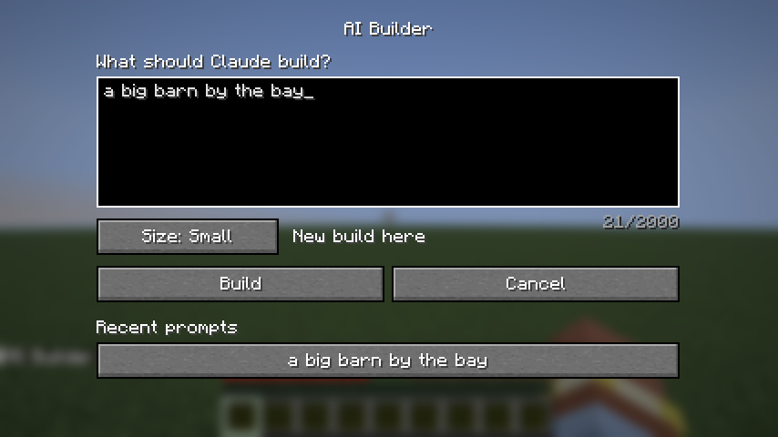

# AI Builder

A mod for **Minecraft Java Edition 26.3** (Fabric) where you press **B**, type anything ("castle", "a cozy cabin
with a dock", "a Japanese garden with a koi pond"), and Claude designs it and builds it in front of you, block by
block, while you watch. It never moves you, ignores your inventory, and `/aibuild undo` puts the land back.

**Status: M1.** The prompt screen works and your prompt reaches the game's server, which says it got it.
Building starts in M2. The plan, milestone by milestone, is in [`PLAN.md`](PLAN.md).



## Using it

| Do | What happens |
|---|---|
| Press **B** in a world | The AI Builder screen opens (rebind it in Options → Controls → Key Binds → AI Builder) |
| Type what you want, pick a **Size**, press **Build** | Chat says `AI Builder got: …` |
| Click a recent prompt (▲ ▼ scroll through the last 10) | It goes back in the box, ready to build again |
| `/aibuild <prompt>` in chat | Same as Build, at Auto size |

The screen remembers your last 10 prompts and the size you picked last. Prompts can be up to 2,000 characters.

## Trying it

From this folder:

```bash
./gradlew runClient
```

This launches a separate development copy of Minecraft with the mod loaded; your normal game and worlds aren't
touched. The first run downloads Minecraft and takes a few minutes.
