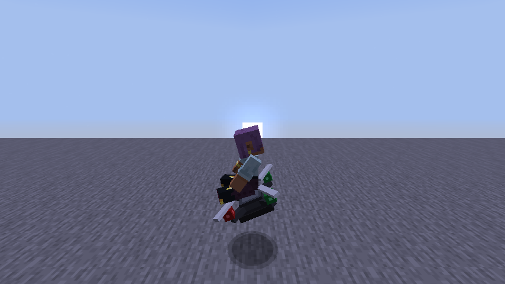

# Drone

A rideable quadcopter for **Minecraft Java Edition 26.3** (Fabric). Hop on and fly it around your world. It handles like a real camera drone: it leans into moves, carries momentum, brakes by tilting back, and holds its altitude when you let go.




## Controls

| Key | Does |
|---|---|
| Right-click the drone | Get on |
| Mouse | Turn (the drone follows where you look) |
| W / S | Tilt forward / back (fly forward / backward) |
| A / D | Tilt left / right (strafe) |
| Space | Climb |
| Sprint key (Left Ctrl) | Descend |
| Shift | Get off (the drone hovers where you leave it) |
| Punch it | Pick it up (creative) |

Red lights mark the **front**, green lights the **back**.

## Getting it

The drone is creative-only. Open the **Tools & Utilities** creative tab, take the **Drone**, and right-click a block to place it.

## Play it in a development copy of Minecraft

You need JDK 25 (see the root [`CLAUDE.md`](../../CLAUDE.md) for setup). Then:

```bash
cd mods/drone
./gradlew runClient
```

This opens a separate copy of Minecraft with the mod loaded. Your normal game and worlds aren't touched.

## Status

v1 is done and play-tested. Ideas for later (sounds, a speed/altitude HUD, other players seeing the tilt, recipes) are listed as non-goals in the [design spec](../../docs/superpowers/specs/2026-10-19-drone-mod-design.md).
