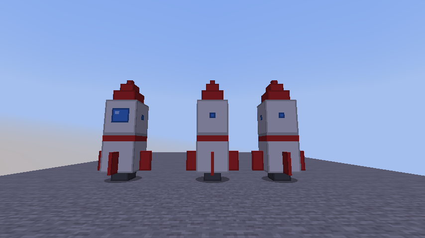
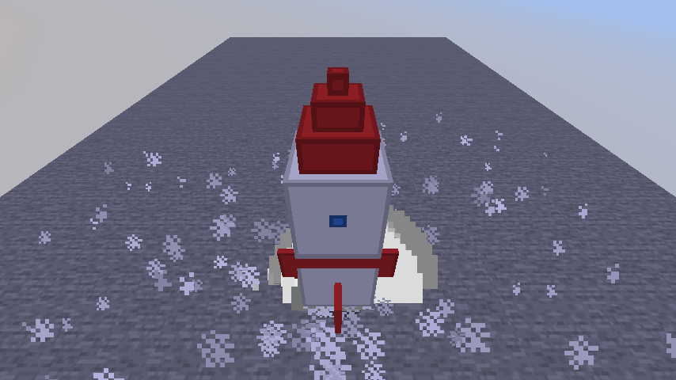

# Rocket

A rideable rocket ship for **Minecraft Java Edition 26.3** (Fabric). Climb in, hold Space, and watch it
ignite: white vapor rolls out across the ground for two seconds, then it lifts off on a column of flame
and smoke and climbs faster and faster. Steer it by tilting the nose. Let go of Space and gravity takes
over, so land it gently by feathering the throttle (or don't: crashes never break anything).





## Controls

| Key | Does |
|---|---|
| Right-click the rocket | Climb in |
| Space, held | On the ground: 2 s ignition, then liftoff. In the air: full throttle |
| Let go of Space | Engine idles and the rocket falls (during ignition: cancels the launch) |
| W / S | Tilt the nose forward / back (it flies that way) |
| A / D | Tilt the nose left / right |
| Mouse | Turn (the rocket follows where you look) |
| Shift | Get out (mid-air, the rocket falls and lands on its own) |
| Punch it | Pick it up (creative) |

The big window is the **front**. You sit inside the cabin and look out through it.

## Getting it

The rocket is creative-only. Open the **Tools & Utilities** creative tab, take the **Rocket**, and
right-click the ground to stand it up. It needs about 1.4 × 1.4 blocks of floor and 5 blocks of headroom.

## Play it in a development copy of Minecraft

You need JDK 25 (see the root [`CLAUDE.md`](../../CLAUDE.md) for setup). Then:

```bash
cd mods/rocket
./gradlew runClient
```

This opens a separate copy of Minecraft with the mod loaded. Your normal game and worlds aren't touched.

## Status

v1 is built and tested; next is Frankie's play-test, then tuning the flight feel. See the root
[`CLAUDE.md`](../../CLAUDE.md) under "Current status".
